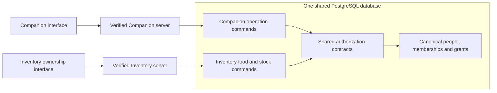

# Shared employee identity and access - design review

Draft design from accepted PR50 main `ce1d3a7a0c7a900699f4330c20ce219042651a66`, with [merged-main CI](https://github.com/jeffwelch0620-png/Companion-and-Scheduling-App/actions/runs/38500932174) passing 884/884. This package defines the next contracts and decisions. It adds no SQL, account provisioning, permission changes, integration or deployment. Published candidate migrations 001-063 remain immutable.

## Outcome and source evidence

Use one person directory, explicit store memberships, reviewed external-ID mappings and one shared authorization service for both interfaces. Companion hosts employee work and the access console; Inventory retains its ownership interface and canonical food/stock/order commands. A shared permission answer does not replace each command's record, consent, independence, revision and accounting checks.

Proposed call path, not an implemented connection:

| Source | Pinned evidence | What it establishes |
| --- | --- | --- |
| Companion candidate and running D1 source | [Companion ce1d3a7](https://github.com/jeffwelch0620-png/Companion-and-Scheduling-App/tree/ce1d3a7a0c7a900699f4330c20ce219042651a66); `001_candidate.sql`, `schema-snapshot.sql`, `task-http.ts`; original `app/shared/employee-login.ts`, `employee-session.ts`, `restaurant-access.ts`, `access-service.ts` | Candidate person/member UUIDs, fictional session resolution and tested scoped commands coexist with the unchanged D1 access/setup lifecycle. They are separate identity systems today. |
| Inventory reviewed source | [Inventory fbf06b7](https://github.com/jeffwelch0620-png/JayMax-Concepts-/tree/fbf06b7c9beda305ef42fb3b06d8215d165202bf); `supabase/schema.sql`, `backend/server.py`, `docs/LEGACY_PREP_CUTOVER_REVIEW.md` | The versioned schema contains `public.people` and `store_roles` alongside `app_users`, `staff_members` and `staff_pins`. Backend login still uses the app-user model; verified employee mapping is deferred in the cutover notes. A shared `authz` implementation was not located in the inspected tracked source. |
| Earlier private proposal | JMAX Shared Employee & Permissions Design, October 8, 2026, 18 pages; its own source pins are Companion `01de083` and Inventory `1a5e972` / `91b028d` | Useful proposed tables and console flow; illustrative SQL and its listed decisions are proposal evidence, not deployment or new authorization. Keep the original private document outside this public repository. |
| Existing isolated authority prototypes | `app/shared/authority-contract-prototype.ts`, `authority-persistence-prototype.ts`, [bridge limits](../../prototypes/FOOD-AUTHORITY-BRIDGE-DRAFT.md) | Explicit grants, person-level attribution and revision guards have fictional mechanics coverage. These prototypes are not imported by active authentication or command paths. |

Inventory source inspection was read-only. The actual source worktree had separate additive-installer work in progress; none of its uncommitted files are an adopted baseline. The `fbf06b7` pin is a source reference, not confirmation of the exact Inventory baseline for integration or the hosted catalog. Before a port, the owner must confirm that baseline, and an authorized catalog reconciliation must identify installed relations, functions, privileges and migration receipts.

## Recorded owner choices and remaining decisions

| ID | Decision | Status |
| --- | --- | --- |
| I01 | Organization-wide owners; an administrator is enabled or disabled by an owner | **Selected by owner in this design review.** No grant is provisioned here. |
| I02 | Ordinary employees may have multiple explicitly reviewed store memberships; each store retains its permission scope | **Selected by owner in this design review.** Replaces the running D1 application's ordinary single-store restriction at eventual adoption. |
| I03 | Personal sign-in and manager-issued setup first; registered tablets with personal PINs later | **Selected by owner in this design review.** Shared store PINs/name selectors are not verified personal identity. |
| I04 | Keep one person UUID and one membership UUID per person/store; retain all legacy text IDs as reviewed aliases; represent extra jobs separately | **Selected by owner after PR51 acceptance.** Shared DDL remains a later slice; do not assume that a canonical UUID equals a legacy member ID. |
| I05 | Employing/payroll entity for commissary-only staff, including people employed centrally rather than by a store | **Pending owner selection.** Physical location and labor cost account do not establish an employer. |
| I06 | Shared migration repository and approval owner; exact adopted Inventory source/catalog baseline | **Pending owner selection/confirmation.** Recommend one authoritative shared migration manifest after adoption, preserving existing chains and receipts. No new repository is created here. |
| I07 | Grant delegation beyond owners/enabled admin; protected owner changes, initial bootstrap/recovery and independent approval | Recommend explicit scoped delegation, no self-grants, no escalation and independent owner-change approval; **pending owner selection**. Console authority is not inferred from a job title. |
| I08 | Sensitive-action authentication, recovery for loss of the last owner, and audit/retired-credential retention | **Pending owner selection and operational review.** No automatic 30-day deletion, automatic admin expiry or infrastructure-key rotation is authorized by the older PDF. |
| I09 | Personal onboarding for staff without email/phone; supported provider invitation/setup flow | **Pending provider feasibility and owner selection.** A manager-issued setup approval must use a reviewed authentication flow; it is not permission to mint arbitrary Supabase identities. |

Commissary labor already has two owner-selected modes: charge verified work to a separate commissary labor account for later allocation, or record direct store prep work. Labor allocation only is selected. Ingredient costs/overhead, payroll employer, actual timekeeping and allocation basis are separate. The older PDF's statement that the commissary owns no labor cost is superseded for this labor design; food/stock ownership is not changed by that choice.

## Proposed canonical relationships

Names below describe the logical shared contract, not installed tables or approved DDL. Resolve fit with existing `public.people`, `stores` and fact foreign keys before creating or renaming anything.

| Relationship | Contract |
| --- | --- |
| Organization / store | Stable organization identity and verified store mappings. Active stores and store configuration determine scope; owner coverage is data-driven, including newly approved stores. No hard-coded owner names or store arrays. |
| Person | One durable human identity UUID. Current display name comes from this repository at read time; audit snapshots retain the name at entry. Ending employment or deleting a login must not delete the person or operational history. |
| Authentication link | Verified provider subject to person mapping, separately audited. A linked login does not grant store membership or capabilities. The first release recommends one active primary provider link per person; account merges/rebinds are exceptional reviewed commands. |
| Membership | Explicit person/store employment association with active/ended/schedule-only state and revision. One membership is not a person; one store is not a physical production location. Extra jobs must not require duplicate people or memberships. |
| Jobs / departments | Explicit effective assignments using the store's configured department and job keys. Preserve the tested primary-department behavior until additional cross-department behavior is approved. No unconditional `Executive -> Management` conversion or global FOH/BOH list. |
| Scheduling eligibility / qualifications | Eligible schedule jobs and training clearances remain distinct from permissions. An imported position/title never proves capability, station clearance, publisher status or evidence-based training completion. |
| Grants | Explicit capability, organization/store/optional location/department scope, effective interval, revision, approving actor and reason. Role templates create review proposals only. Unknown capability codes or unmapped scopes fail closed. |
| Owner / enabled admin | Organization-scoped authority independent of an employment membership. Admin enablement is owner-controlled; ordinary permissions can remain when disabled. Recommend prohibiting admin changes to owners or their own enablement. Shared ownership notice recipients resolve from current owners plus the owner-enabled admin. |
| External identity | Unique source namespace, organization/store and external ID linked to a reviewed person/member. Legacy app-user, staff-member, Companion-member, Toast and schedule-export aliases remain separately identifiable. Matching names/email alone never binds accounts or merges people. |
| Physical location / labor account | Store premises and internal production locations are separate from employing store, stock owner and labor charge account. Both selected commissary labor modes are supported without inventing a commissary employment membership. |
| Access audit / application session control | Append-only before/after decisions with person actor, verified session/provenance, reason and revisions; separate app-owned suspension/revocation state. Do not archive login secrets or place real mappings in Git. |

An organization owner without a store employment membership must still have a verifiable person actor. Do not create fictitious employment rows merely to satisfy candidate actor foreign keys. Candidate commands currently bind member actors; the port must review person actor columns plus optional acting-membership attribution and update those definitions explicitly. Existing member actor IDs and snapshots remain historical evidence.

Sharing a directory does not expose every person's fields to both interfaces. Employee projections include only authorized names and operational fields; contact information, compensation, other-store memberships, coworker grants and private personnel history need their own scoped reads. Both apps resolve display names through this controlled projection, not unrestricted SELECT on people or a copied complete directory. Ending one store membership does not disable another approved membership; global person suspension is a separate audited action.

## Identity and authorization boundary

1. Personal sign-in proves a provider subject/session. The server verifies issuer, audience, signature, expiry and supported session claims. A client-selected name, member ID, store PIN, `owner_admin` title or capability array never proves the actor.
2. Resolve that subject to a current person and application session state. Check inactive/suspended/revoked identity and account-link revision. Unknown/unlinked users have no operational authority. Store selection is a requested resource scope, not a new actor identity.
3. Load current organization/store/location/department scope and explicit effective grants. Schedule-only records may appear in scheduling eligibility where current policy allows, but cannot sign in or receive operational authority.
4. A single shared policy implementation evaluates scope/capabilities; each command applies its existing contextual rules. Both UIs consume server-projected actions, not separate copies of the authority logic.
5. Reads use a consistent authorized snapshot without coordination locks, with current identity/access fences for multi-page loads. For source target reads, apply the later accepted separate current final-access check in the [target-read contract](SOURCE_NORMALIZATION_TARGET_READ_DESIGN.md): discard the assembled private result if revocation committed before that check. See the proposed [reviewer-access design](SOURCE_REVIEWER_ACCESS_DESIGN.md) for its fence and lifecycle. Other already delivered responses cannot be retracted; every subsequent request checks current authority.
6. Writes and receipt reads/replays check current authority. For a new command, check a matching receipt before mutable source/status validation, without bypassing authentication, current permission or payload matching. A revoked actor cannot retrieve a private historical receipt merely by knowing its request ID.

Retain the original 14 Companion capability meanings and the separately approved `schedule.correct` contract. In particular, `schedule.change` governs published changes, while `schedule.manage` governs draft planning; the PDF's alternative label is not adopted. `location.manage` widens a held operational permission where tested rules allow; it does not replace that permission. Checkout-role restrictions use configured role keys, not a global position/tier string.

The selected owner model does not create a universal workflow bypass. `schedule.correct` remains separate and initially granted to nobody; provisioning for eligible ownership/GM/designated managers is explicit. Another person's completed correction needs a reason and ownership notice; own-person correction needs a distinct authorized approver. Existing self-assigned leadership, reasoned active-shift editing, manager-approved department-changing swaps, manager-only initial attendance, retained attendance self-actions and reasoned retrospective own-flag resolution remain as approved. Independence compares person IDs across memberships. Read-only access for ownership notice recipients needs its own scoped read policy; do not grant correction writes to make a notice readable.

Disabling the app's administrator switch does not remove infrastructure permissions, database/operator credentials or repository access. Review those privileges separately at adoption; do not describe an application flag as revoking Supabase dashboard or GitHub authority. Infrastructure credential changes remain separate operator actions.

## Hosted authentication and least privilege

The first implementation should retain a trusted backend boundary for both applications, calling the same shared policy/command contracts. Direct browser RPC is a later reviewed transport option. Private helpers taking person/subject parameters are not browser-callable. If RPC is exposed, its wrapper must derive identity from verified database auth context and enforce resource scope; simply exposing the candidate `p_subject` functions would allow spoofing.

Supabase JWTs contain a `session_id`; signed JWT validity alone does not imply the user has not signed out. The [session documentation](https://supabase.com/docs/guides/auth/sessions) describes checking the associated session and the delay in some lifetime controls. Define and test both provider-session validation and app-controlled revocation. A custom authorization-epoch claim is optional, not a substitute for current permission checks. Do not promise automatic refresh/retry on every 403; a true denial remains a denial, and uncertain commands retain their original request.

Use app-owned coordinated write functions for memberships/grants/link changes, not custom triggers on Supabase-managed `auth.sessions`. Provider session creation/revocation does not participate automatically in application locks. Provider logout cannot retroactively cancel an already-authorized write; test and document the next-request guarantee. [Supabase user-data guidance](https://supabase.com/docs/guides/auth/managing-user-data) distinguishes managed Auth objects from application profiles. Any FK to `auth.users` must preserve durable business people/history when a login is removed, rather than copying the cascading profile-deletion example.

Runtime credentials need only reviewed reads and command execution; they must not grant users direct changes to identity, grants, audit, stock or receipts. RLS and backend checks both matter: [service-role access bypasses RLS](https://supabase.com/docs/guides/database/postgres/row-level-security), so merely enabling policies does not protect a privileged legacy command. Isolate operator credentials and inventory accounting writers. [Database function guidance](https://supabase.com/docs/guides/database/functions) requires reviewing function execution grants, fixed search paths and actor checks; SECURITY DEFINER helpers stay private and schema-qualified. Catalogue actual grants rather than assuming project defaults.

Personal setup must retain one-use, short-lived, hashed approvals, rate limiting and audit. Ordinary reissue must not impersonate an existing linked person or silently replace a login. Recovery/rebind separately verifies the person, revokes superseded sessions and notifies appropriate recipients. The provider/Auth side effect is not a PostgreSQL transaction: use an idempotent onboarding intent with pending, provider-created, linked and failed states; grant no operational access until the verified link and independent access review commit. Reconciliation handles a provider timeout without creating another human identity.

## Coordination and revision contract to validate

The shared port must adopt one lock order across commands, access writes and imports, rather than mixing the candidate's store-first locks with the PDF's person-first sketch. Proposed order: an application-owned organization policy gate, sorted affected store coordination rows, then sorted person/policy/member/grant rows, then operational records. The organization gate is shared for ordinary writes and exclusive for organization-wide ownership/store-scope changes; ordinary reads acquire none. This is a design to test, not a new lock implementation.

Any person-wide epoch/link/identity mutation must coordinate all affected memberships/stores before taking the exclusive person policy lock. Revalidate the affected-scope set under the locks; if it changed, abort and retry from a fresh plan. Cross-store leave/booking effects likewise determine all affected stores first. Per-store grant edits must not lock only one store and then change a globally shared person row while another store's command holds it. Store-only operational work keeps the current per-store serialization behavior.

Shared access functions acquire coordination before their first mutation, including deletes; they cannot rely on a child trigger finding an already-deleted parent. Unexpected row-first callers retain a NOWAIT/retry backstop. SQLSTATE 40001 means retry the whole SQL transaction with the same receipt/batch ID, bounded backoff and no external side effects in the callback. Preserve the existing HTTP `503 coordination_retry` and frozen-submission contract.

Access changes advance access/person/membership/grant revisions according to their semantic effect. Preserve existing global workspace, schedule, source-input, attendance and correction counters: routine operational activity must not become an access revocation, attendance drain restart or weekly-publication conflict. Changes to relevant employment/job/department state invalidate scheduling input review; semantic no-ops do not. Ownership-recipient policy changes advance the relevant correction/read-access fences. Do not use one global revision for every UI.

## Review gates and implementation slices

1. Confirm pending decisions, the shared schema/migration owner and the Inventory source/catalog baseline. Inventory inspection in this package does not authorize changes there.
2. Build an isolated shared identity/authorization foundation with fictional people and explicit function definitions. Use the next free candidate corrective number at implementation time if changing this package; do not repurpose 001-063 or copy/renumber Inventory's accepted migration ledger.
3. Implement verified onboarding, grant console and scoped session/recovery contracts, including failure reconciliation. Owner bootstrap is a separately reviewed operator action using verified account IDs, not first-login ownership or hard-coded names.
4. Port candidate identity reads, grants, actor/audit attribution, ownership notice reads and coordination incrementally, with parity tests before deleting fixture bridges. Port the [ingestion contract](SOURCE_INGESTION_DESIGN.md) separately; ingestion never grants sign-in or authority.
5. After Inventory baseline confirmation, port its authenticated commands and actor mappings with its own reviewers. Retain accounting writer ownership and immutable historical evidence. Do not retire a legacy entry point until its consumer, replacement policy and rollback path are verified.
6. Rehearse devices, notification delivery, restore and module-by-module cutover. Git acceptance, shared database application and deployment are separate approvals.

Required scenarios include same-person/two-store identity with different permissions; duplicate email/name without automatic merge; extra job without duplicated membership; checkout/schedule-only denials; an owner without employment membership; admin disablement without owner/self escalation; unknown/stale/expired grants; provider logout and app suspension; revocation between read and write/replay; new-store changes during scope planning; cross-store imports/retries; person-level independent approval; notice-only reads without correction writes; and preservation of legacy unverified actor labels. Each permitted action needs a positive counterpart; testing only denials is insufficient.

Acceptance of this document settles only its recorded choices and review contract. It does not certify complete shared identity, RLS, live session behavior or production readiness.

## Accepted design and read-only follow-up

PR51 was owner-approved and squash-merged at `1323c9e` from reviewed head `3de7d98`, with 884/884 [merged-main CI tests](https://github.com/jeffwelch0620-png/Companion-and-Scheduling-App/actions/runs/38503508302). The owner subsequently selected I04's UUID/alias/job model. The [read-only mapping preview](SOURCE_MAPPING_PREVIEW_CHECKPOINT.md) starts from that accepted baseline with fictional normalized files; it does not implement shared tables, logins, grants or live source access. I05-I09 remain pending.

PR52 accepted that preview at `65f23e6`, with 905/905 merged-main CI. The next [normalization/authorized target-read design](SOURCE_NORMALIZATION_TARGET_READ_DESIGN.md) records the owner's October 13 selection of owners/enabled admin plus explicitly designated store reviewers for authorized source mapping review and completeness certification. This is source-review authority only; person creation/rebinding, membership approval, sign-in/grants and identity/access delegation under I07 retain their independent decisions and workflows. A reviewer without directory authority cannot enumerate other people to resolve an alias. Missing source records require explicit reconciliation and preserve current targets. No shared identity implementation or actual certification is supplied by the design.

During PR53 review the owner additionally selected owners/currently enabled admin only to designate or revoke store source reviewers, with no self-designation and an audit for each change. This settles that source-review policy only; broader identity/access grant delegation and owner bootstrap/recovery under I07 remain pending. The design implements no designation or capability grant.
